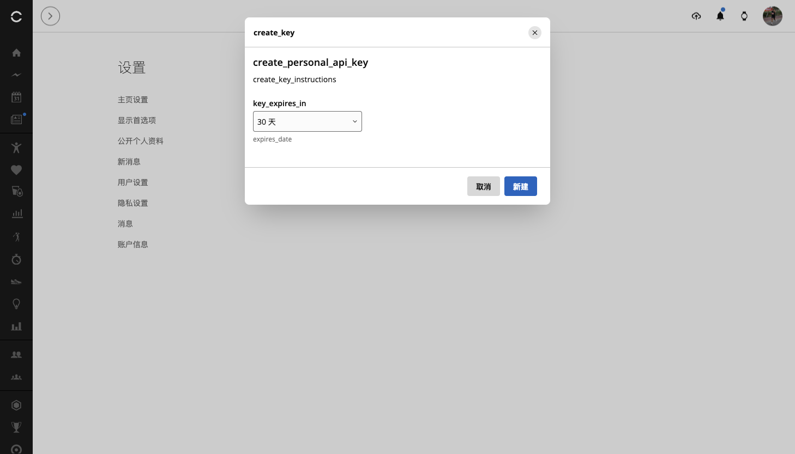
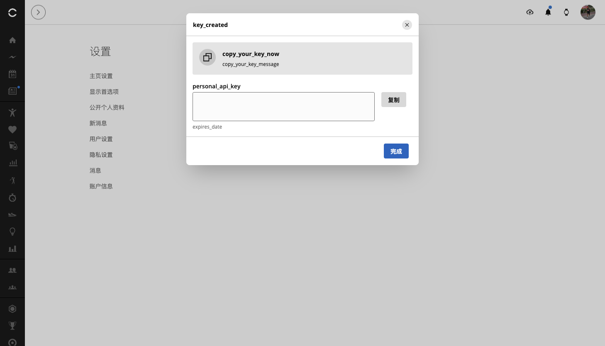

# 佳明官方个人数据接入API保姆级指南

作者：李二牛 · 更新于 2026 年 10 月 22 日

佳明提供了 **Garmin Connect Personal API**：自己生成一把 API Key，交给本机程序，就能读取官方开放的个人数据。接入程序不需要拿到你的佳明密码。[官方说明](https://developer.garmin.com/gc-developer-program/personal/personal-api/)

这篇文章带你从申请入口走到连接验证，也把大陆账号本次遇到的问题说清楚。**生成成功和读取成功，是两个需要分别检查的步骤。** 下方六张图均来自本次大陆账号操作，敏感内容已移除。

## 第一步：先看它适不适合你

Personal API 面向个人读取自己的数据，不是面向多用户商业服务的统一授权方案。当前官方文档列出 26 个 GET 数据接口，可以获取活动、睡眠、步数、心率、HRV、血氧、压力、身体电量等，也支持下载原始活动文件。呼吸方面有日汇总、睡眠等字段，不能直接等同于完整全天曲线。[官方 FAQ](https://developer.garmin.com/gc-developer-program/personal/personal-faq/) · [接口文档](https://developer.garmin.com/gc-developer-program/personal/swagger-docs/)

**创建或删除训练课表、调整日历排期、Webhook 推送，当前均未列入这套公开接口。** 插件另有 **Connect 网页会话（原有方式）**，继续用于训练管理。它虽然在 Garmin 官方页面登录，其网页会话调用并不等于 Personal API 官方授权，两种接入方式按账号独立配置。


*图 1：先从 Garmin 官方说明进入，认准 developer.garmin.com。*

## 第二步：登录对应地区，找到密钥页面

国际账号可以从官方说明中的链接进入 [Personal API Key 页面](https://connect.garmin.com/app/settings/personalApiToken)，在 Garmin 官方网页完成登录。

大陆账号需要单独检查。本次实测，普通设置导航没有出现新入口，但登录大陆站后，直达 [大陆 Personal API 页面](https://connect.garmin.cn/app/settings/personalApiToken) 可以看到创建按钮。**能看到页面，只能确认入口可访问。**


*图 2：大陆页面显示 `create_key`，部分文案尚未翻译。*

## 第三步：阅读条款，选择有效期

点击 **Create Key／创建密钥**，阅读并接受页面条款，再选择有效期。官方提供 30 天、90 天、180 天和一年；首次试用可以先选 30 天。

本次大陆页面的条款只显示 `personal_api_*` 占位符。下图记录这个异常，不代表条款已经正常展示；遇到相同情况，应先确认可读条款或等待页面修复。本次是在账号所有者明确授权后继续测试的。


*图 3：占位符不是完整条款，不能据此判断具体授权内容。*



*图 4：本次选择最短的 30 天有效期，再点击新建。*

## 第四步：复制一次，保存在本机

创建后，**完整 API Key 只显示一次**。先保存，再点完成；丢失后需要删除旧 Key、重新生成。API Key 与访问令牌都属于敏感凭据，不要发到 AI 聊天、评论区或教程截图中。

可以使用密码管理器，或存入仅自己可读的本机文件。macOS／Linux 可将密钥文件权限设为 `600`，父目录设为 `700`；Windows 使用仅当前用户可访问的权限。**文件权限保护不等于加密。**



*图 5：这里只展示创建结果；真实密钥已从截图中移除。*

完成后重新加载页面，检查是否仍有密钥记录。需要停止授权时，在这里删除 Key；官方说明，关联访问令牌也会随之失效。


*图 6：本次大陆账号刷新后仍保留记录，但还要继续验证 API 请求。*

## 第五步：接入 DeepSeek Harness 或其他 Agent

**以下是本次开发版的接入方法；npm 已发布的 0.1.18 尚不包含 Personal API 功能。** 新功能正式发布后，再按对应版本安装，不要以为安装当前 `latest` 就已经具备它。

在包含此功能的 Harness 插件设置中：点击 **+** 添加账号，选择 **官方 Personal API Key（只读）**，填写账号别名和 API Key，再保存并点击 **验证连接**。这种方式不要求邮箱，也不需要在插件中输入佳明密码。**地区必须与创建 Key 的区域对应：国际区用 `.com`，大陆区用 `.cn`，不混用。**

其他 coding agent 可通过 MCP 使用。将本次开发版构建好，把下面两个绝对路径换成自己的路径，重新加载 MCP：

```json
{
  "mcpServers": {
    "garmin-personal": {
      "command": "node",
      "args": ["/absolute/path/to/garmin-connect-plugin-for-dsh/lib/mcp.js"],
      "env": {
        "GARMIN_PROVIDER": "personal",
        "GARMIN_ACCOUNT": "my-garmin",
        "GARMIN_REGION": "global",
        "GARMIN_PERSONAL_API_KEY_FILE": "/absolute/private/path/garmin-personal.key"
      }
    }
  }
}
```

文件只存密钥本身，不加 JSON 包装。大陆账号将 `GARMIN_REGION` 改为 `cn`，服务会使用 `personal.connectapi.garmin.cn`；国际账号的 `global` 对应 `personal.connectapi.garmin.com`。配置中填写文件路径即可，不把真实 Key 放进可分享的配置。插件包含所需 SDK，无需额外安装 TypeScript 库。

## 第六步：先做小查询，再分析趋势

先让 Agent **读取当前账号资料，确认连接和目标账号**；成功后再查最近一天的步数、睡眠，最后查询一段时间的 HRV 或活动。只有返回真实数据，才算完整走通。

API Key 会先换成访问令牌，再调用数据接口。令牌最长有效 24 小时，且不超过 Key 本身有效期；官方不提供 refresh token，过期后要用 Key 重新获取。界面里的“验证连接”不是再次登录佳明。[认证 FAQ](https://developer.garmin.com/gc-developer-program/personal/personal-faq/)

## 大陆账号本次到底成功了吗？

截至本文日期，**大陆账号已创建 Key；本轮用新 TS SDK 请求对应 `.cn` 端点，仍未跑通读取链路**：

| 检查项 | 本次结果 |
|---|---|
| 创建 30 天 Key、刷新后保留记录 | 成功 |
| 将大陆 Key 发往国际区 `.com` 令牌接口 | HTTP 404／`NotFoundException`，找不到对应 Key ID，属于跨区请求结果 |
| 用新 TS SDK 将大陆 Key 发往对应 `.cn` 端点 | 换取令牌返回 HTTP 526／`TOKEN_EXCHANGE_FAILED` |
| 取得令牌、读取账户设置或健康数据 | 未完成；未取得令牌，也未执行后续读取 |
| 先前 `.cn` 无凭据检查 | 返回 526；当时没有向它发送真实 Key |

官方文档示例目前公开 `.com`。本次实现将大陆 Key 明确发往对应 `.cn` 端点；SDK 支持地区配置，不等于端点本次可用。此前跨区 `.com` 的 404 与这次 `.cn` 的 526 是两项不同结果：前者不能用于判断大陆支持情况，后者只说明本次服务访问失败。**目前尚未验证大陆读取成功，也不能断言大陆全面不支持。**

我们参考 [Garmin 官方 Python 客户端](https://github.com/garmin/connect-personal-api-python)，已建立独立仓库 [connect-personal-api-ts](https://github.com/Likenttt/connect-personal-api-ts)，维护 TypeScript 实现。**新 SDK 专注 Personal API Key 换取令牌和读取数据**。仓库代码已建立，本轮尚未发布 npm，使用时以包含此功能的实际版本为准。

**让 AI 分析数据，凭据留在本机。先验证一个账号、一项读取，再逐步扩大使用范围。**
