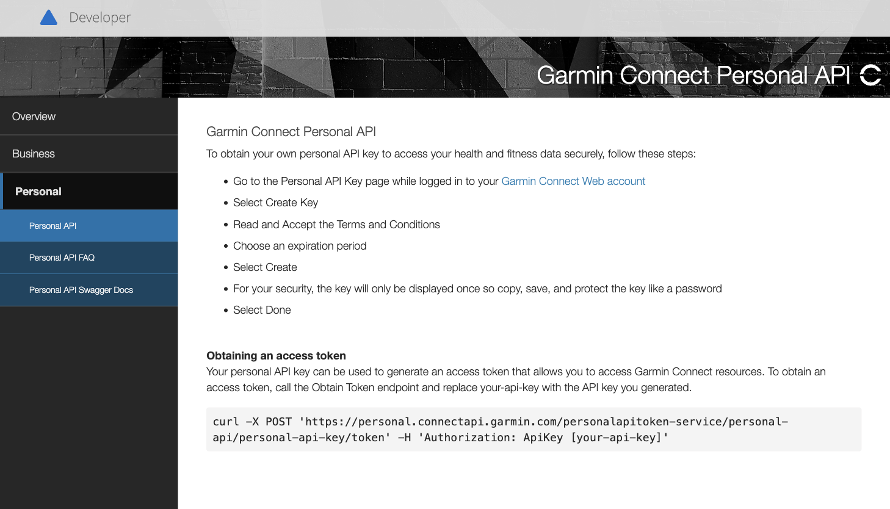
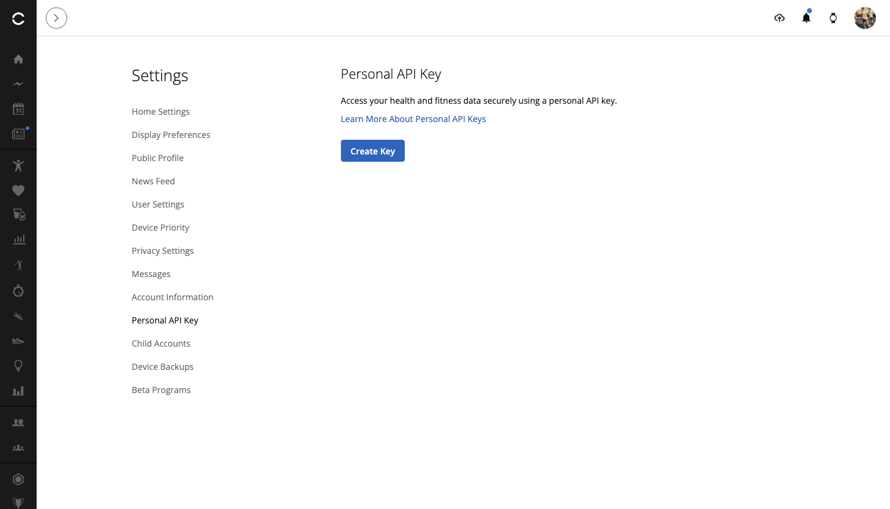
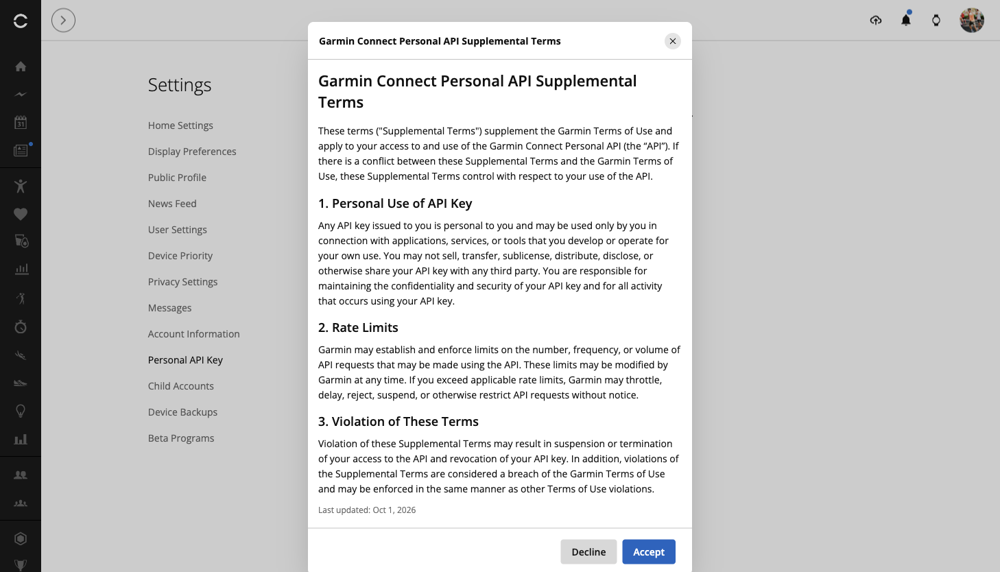
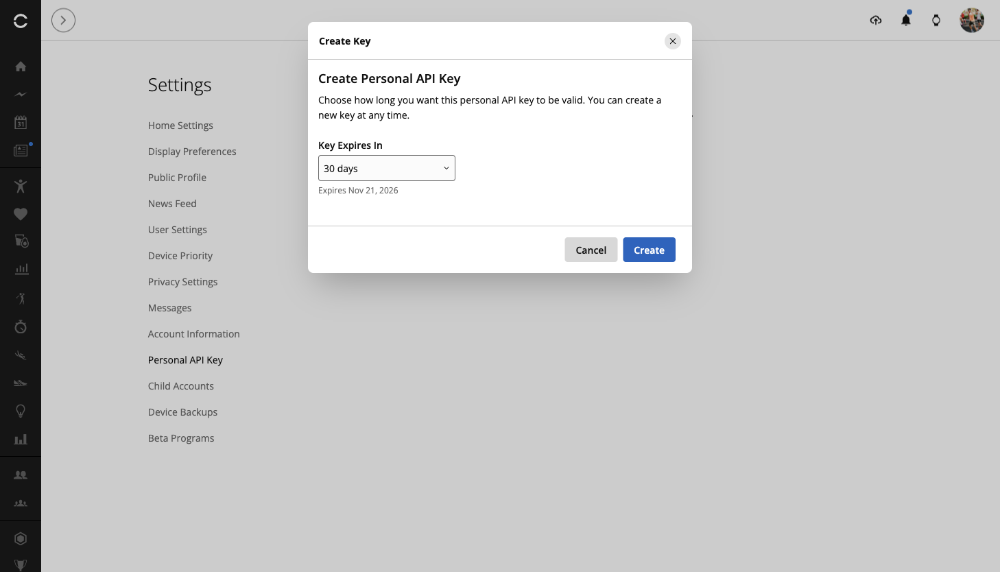
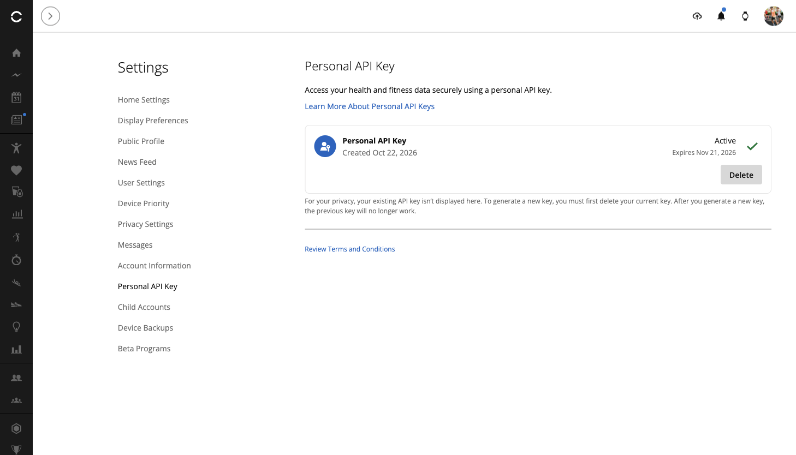
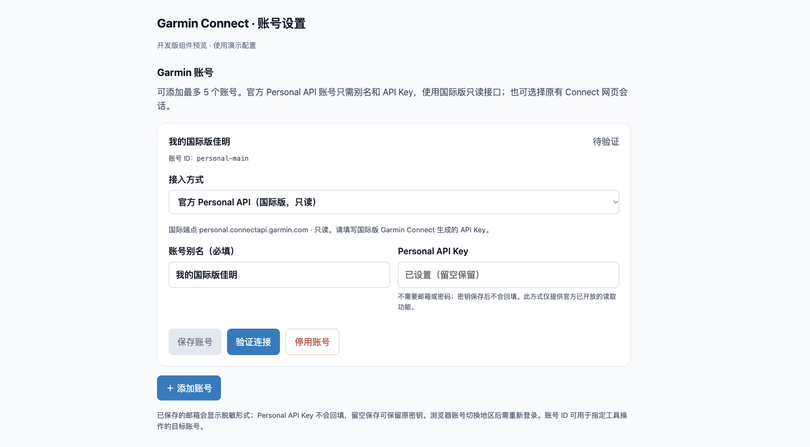

# 佳明官方个人数据接入API保姆级指南

作者：李二牛 · 更新于 2026 年 10 月 22 日

本文使用的是李二牛开发的开源社区插件 **[dsh-plugin-garmin-connect](https://github.com/Likenttt/garmin-connect-plugin-for-dsh)**。它既是 DeepSeek Harness 插件，也能作为 MCP 服务连接其他 Agent；项目介绍见 [gc.li2niu.com](https://gc.li2niu.com/)。

这次是在已有插件中新增 **Garmin 官方 Personal API 模式**：官网生成 Key，插件换取令牌、读取数据，佳明密码不用交给 AI。底层使用独立维护的 `connect-personal-api-ts`，用户安装插件即可，无需另装 SDK。

**这次国际版已经实测跑通：令牌交换、8 项 SDK 读取、5 项真实 MCP 工具读取全部通过。** 下面以国际版为主，带你申请 Key，再连接 DeepSeek Harness 或其他 Agent。大陆入口与当前情况放在文末。[完整测试报告](../research/personal-api-endpoint-test-report-2026-10-22.md)

## 一、先弄清它能做什么

Personal API 用于个人读取自己的数据。官方当前公开 26 个 GET 数据接口，覆盖活动、步数、睡眠、心率、HRV、血氧、压力、身体电量等，也能下载原始活动文件。呼吸数据包含日汇总、睡眠等字段，不能等同于完整全天曲线。[官方 FAQ](https://developer.garmin.com/gc-developer-program/personal/personal-faq/) · [接口文档](https://developer.garmin.com/gc-developer-program/personal/swagger-docs/)

同一个 `dsh-plugin-garmin-connect` 插件有两种接入方式：

| 接入方式 | 如何配置 | 主要用途 |
|---|---|---|
| 官方 Personal API（当前国际版只读） | 别名 + API Key | 活动、睡眠、HRV、血氧、呼吸摘要等读取 |
| Connect 网页会话（原有方式） | 使用原有 Garmin 登录流程 | 数据读取，以及训练库／排期管理，依实际工具能力执行 |

**插件的课表与日历管理能力继续由 Connect 网页会话提供**，写操作仍需预览和确认。Personal 模式当前只读，其公开范围也未包含 Webhook。



*图 1：官方说明列出了申请步骤，以及 API Key 换取令牌的方法。*

## 二、打开国际版密钥页面

在浏览器打开 [国际版 Personal API Key 页面](https://connect.garmin.com/app/settings/personalApiToken)，使用你的**国际版 Garmin 账号**完成登录。也可以从 [Garmin 官方说明](https://developer.garmin.com/gc-developer-program/personal/personal-api/)中的链接进入。

进入后，设置列表中会出现 **Personal API Key**，右侧点击 **Create Key**。



*图 2：国际版设置页有正式入口，点击 Create Key 开始申请。*

## 三、阅读条款，先选 30 天

阅读 **Garmin Connect Personal API Supplemental Terms**，确认后点击 **Accept**。这把 Key 用来访问你自己的数据，请为个人使用的程序配置，不要分享给其他人。



*图 3：国际版条款可以正常显示，阅读后自行决定是否接受。*

下一步选择有效期。官方提供 30 天、90 天、180 天和一年；首次体验建议选 **30 days**，再点击 **Create**。本次国际 Key 的有效期为 2026 年 10 月 22 日至 11 月 21 日。



*图 4：这里选择 30 days，然后点击 Create。*

## 四、保存 Key，再检查 Active 状态

**完整 API Key 只显示一次。** 创建后先复制并妥善保存，再点击完成；如果丢失，需要删除旧 Key、重新生成。不要把 Key 发给 AI、粘贴到评论区或留在截图里。本文不展示一次性密钥画面。

保存后刷新页面，检查状态是否为 **Active**，以及到期日是否正确。下图是真实刷新后的管理页面，**它显示密钥记录，不显示完整 Key**。



*图 5：状态为 Active，到期日为 2026 年 11 月 21 日；需要停止授权时可在这里 Delete。*

## 五、在 DeepSeek Harness 里接入

**以下设置属于本次源码开发版，npm 已发布的 0.1.18 尚不包含 Personal 接入。** 正式版发布后可按新版本安装；现在体验需要使用 [Personal 开发分支](https://github.com/Likenttt/garmin-connect-plugin-for-dsh/tree/codex/personal-api)构建的插件，不能直接安装旧版 `latest` 代替。

新用户先安装本次开发版；原用户更新后可以保留已有网页会话账号，再新增 Personal 账号。按顺序操作：

1. 打开 Harness 的**插件**页面，找到 **dsh-plugin-garmin-connect**，进入账号设置。
2. 点击 **+ 添加账号**，接入方式选择 **官方 Personal API（国际版，只读）**。
3. 填写**别名**，例如“我的佳明国际版”；再填写官网刚生成的 **API Key**。
4. 点击**保存账号**，随后点击**验证连接**；验证成功后即可开始查询。

**新建 Personal 账号只需要别名和 API Key 两项，默认连接国际版。** 不填邮箱、密码或地区，也不需要再次打开佳明登录页。Key 只在插件设置中输入，保存后不回填完整内容。

建议用 **+ 添加账号**保留两种方式。若修改已有账号的接入方式，需要提供新方式的凭据：Personal 填 API Key，网页会话重新完成对应登录。



*图 6：开发版账号表单组件预览：只填写别名和 API Key。使用演示配置渲染。*

### 开发者：安装当前源码版

源码体验者可先构建本地安装包：

```bash
git clone --branch codex/personal-api --single-branch https://github.com/Likenttt/garmin-connect-plugin-for-dsh.git
cd garmin-connect-plugin-for-dsh
npm ci
npm run build
npm pack --ignore-scripts
```

把生成的安装包路径换成你自己的绝对路径，安装到实际使用的 Harness profile：

```bash
npx @deepseek-ai/dsh plugin --profile web add /absolute/path/dsh-plugin-garmin-connect-0.1.19-dev.0.tgz
```

重新加载插件或重启对应 Harness profile，再打开账号设置。已使用其他 profile 的用户，把示例中的 `web` 换成自己的 profile 名。

## 六、其他 Agent：用 MCP 接入

Codex、Claude Code 等支持 stdio MCP 的客户端，运行的是**同一插件包 `dsh-plugin-garmin-connect` 的 `lib/mcp.js`**。Harness 设置与独立 MCP 进程分别配置账号；在 DSH 保存的别名和 Key 不会自动同步到 MCP。

先创建一个仅自己可读的 UTF-8 纯文本文件，**内容只放 API Key，不加引号或 JSON 包装**。macOS／Linux 文件权限设为 `600`，父目录设为 `700`；Windows 使用仅当前用户可访问的权限。这属于文件权限保护，不等于加密。

在客户端的 MCP 配置中添加以下内容，并替换两个绝对路径：

```json
{
  "mcpServers": {
    "garmin-personal": {
      "command": "node",
      "args": ["/absolute/path/to/garmin-connect-plugin-for-dsh/lib/mcp.js"],
      "env": {
        "GARMIN_PROVIDER": "personal",
        "GARMIN_ACCOUNT": "my-garmin",
        "GARMIN_ALIAS": "我的佳明国际版",
        "GARMIN_REGION": "global",
        "GARMIN_PERSONAL_API_KEY_FILE": "/absolute/private/path/garmin-personal.key"
      }
    }
  }
}
```

`GARMIN_ALIAS` 是便于辨认的别名，`GARMIN_ACCOUNT` 是稳定的机器 ID；不要把两者当作邮箱。国际 Key 使用 `global`，请求 `personal.connectapi.garmin.com`。也可以通过客户端私密环境注入 `GARMIN_PERSONAL_API_KEY`，但不要把真实 Key 写进可分享的 JSON。此模式无需 `GARMIN_USERNAME`，也无需另外安装 SDK。

保存配置后，重新加载 MCP，确认 Garmin 工具出现，再让 Agent 执行：

**“先读取我的 Garmin 账号资料确认连接，再查看昨天的 HRV、血氧和呼吸摘要；暂时不用制定计划。”**

本次已验证 MCP 的 profile、活动、HRV、血氧、呼吸 5 项读取。呼吸返回的是每日摘要。先用小查询确认账号与日期，再逐步分析趋势；工具存在和读取成功要分别确认。

## 七、大陆账号：有入口，本次暂不可访问

大陆账号可在登录后直达 [大陆 Personal API Key 页面](https://connect.garmin.cn/app/settings/personalApiToken)。本次可以创建 30 天 Key，刷新后记录保留，但部分文案及条款显示为占位符。

使用**大陆 Key 请求对应 `personal.connectapi.garmin.cn`**，本轮换取令牌返回 **HTTP 526／`TOKEN_EXCHANGE_FAILED`**，没有取得 token，也没有继续读取健康数据。当前只能说**大陆端点本次暂时无法访问**，不能据此断言永久不支持。

国际用国际 Key，大陆用大陆 Key，分开保存、不跨区回退。MCP 保留 `GARMIN_REGION=cn` 配置；已经保存的大陆 Personal 账号会保留区域并显示暂不可访问提示。新建 Harness Personal 账号默认国际版，不能把大陆 Key 当国际 Key 填入。

最后补充：访问令牌最长有效 24 小时，且不超过 Key 的到期时间；过期后用 Key 重新获取，没有 refresh token。[认证 FAQ](https://developer.garmin.com/gc-developer-program/personal/personal-faq/)

底层 [connect-personal-api-ts](https://github.com/Likenttt/connect-personal-api-ts) 参考 [Garmin 官方 Python 客户端](https://github.com/garmin/connect-personal-api-python)，专注 Personal Key、token 与数据读取。本轮是源码开发验证，尚未发布对应 npm 升级版。

## 八、连接后，用这个插件问两句

1. “用 dsh-plugin-garmin-connect 读取我最近 7 天的 HRV 和睡眠，按日期整理，并标出缺失的数据。”
2. “用这个插件对比最近两次跑步的配速和心率，再汇总昨天的血氧和呼吸摘要，只解释实际返回的数据。”

**让 AI 分析数据，把密钥留在你控制的本机配置里。**
