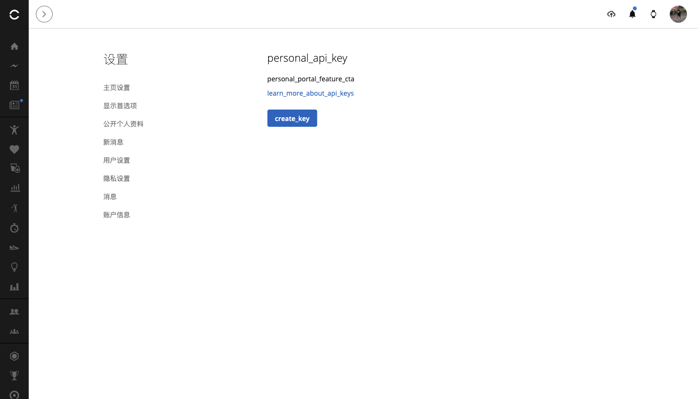
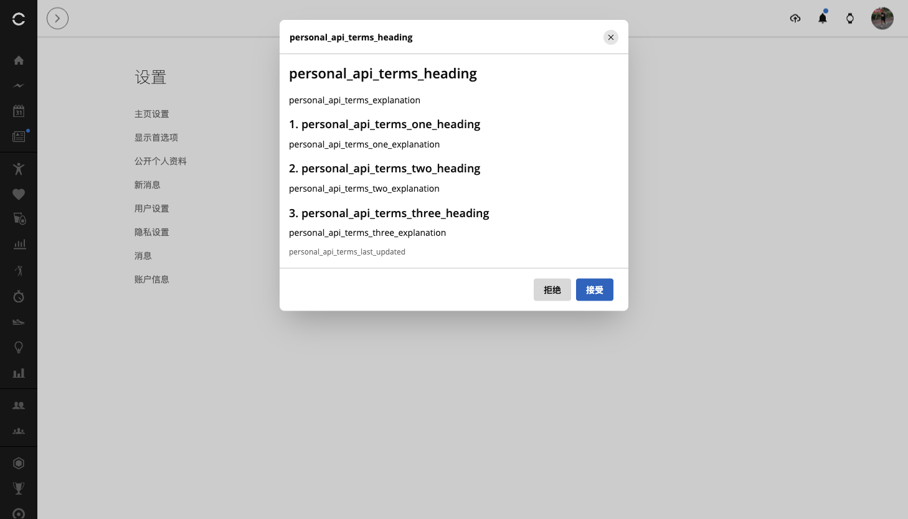
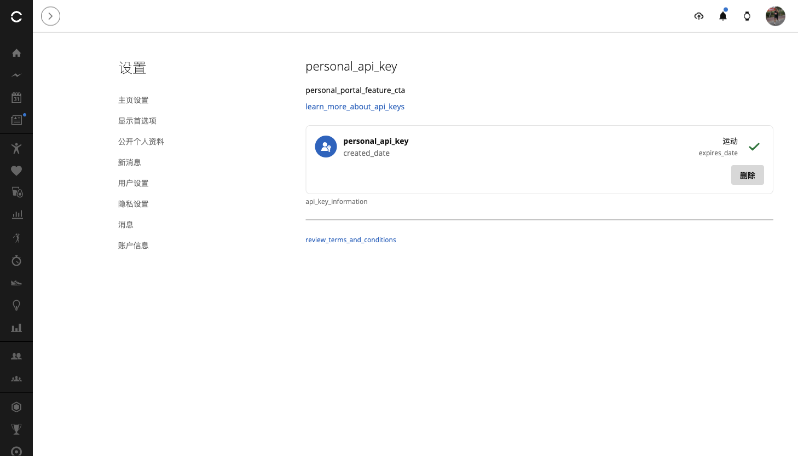

# 佳明官方个人数据接入API保姆级指南

作者：李二牛 · 更新于 2026 年 10 月 22 日

佳明终于推出了官方 **Personal API 模式**，还提供了 [Python 版 SDK](https://github.com/garmin/connect-personal-api-python)。我很快参考官方实现移植了 [TypeScript 版本](https://github.com/Likenttt/connect-personal-api-ts)，并接入 [dsh-plugin-garmin-connect](https://github.com/Likenttt/garmin-connect-plugin-for-dsh)，让 DeepSeek Harness 和 MCP 都能使用。**TS 版代码已经开源，欢迎点个 Star。** [SDK 0.1.0 已发布到官方 npm](https://www.npmjs.com/package/@likenttt/connect-personal-api-ts)。

我是李二牛，TypeScript SDK 和插件由我在社区维护，**TS 版并非 Garmin 官方 SDK**。这次是在已有插件中增加官方 Personal API 接入：官网生成 Key，插件换取令牌、读取数据，佳明密码不用交给 AI。插件同时提供 DSH 和 MCP 形态，用户无需另装底层 SDK；项目介绍见 [gc.li2niu.com](https://gc.li2niu.com/)。

**这次国际版已经实测跑通：令牌交换、8 项 SDK 读取、5 项真实 MCP 工具读取全部通过。** 下面以国际版为主，带你申请 Key，再连接 DeepSeek Harness 或其他 Agent。大陆入口与当前情况放在文末。[完整测试报告](../research/personal-api-endpoint-test-report-2026-10-22.md)

## 一、先弄清它能做什么

Personal API 用于个人读取自己的数据。官方当前公开 26 个 GET 数据接口，覆盖活动、步数、睡眠、心率、HRV、血氧、压力、身体电量等，也能下载原始活动文件。呼吸数据包含日汇总、睡眠等字段，<span style="color: #b42318; font-weight: 600;">暂无独立的完整全天呼吸曲线接口</span>。[官方 FAQ](https://developer.garmin.com/gc-developer-program/personal/personal-faq/) · [接口文档](https://developer.garmin.com/gc-developer-program/personal/swagger-docs/)

同一个 `dsh-plugin-garmin-connect` 插件有两种接入方式：

| 比较维度 | 账号密码／Connect 网页会话 | Personal API Key |
|---|---|---|
| 登录输入 | 在 Garmin 官方表单输入账号、密码，按需完成验证码 | 在 Garmin 官网申领 Key，后续由 Key 换取 token |
| 插件配置 | 邮箱、区域、可选别名，再完成网页登录 | 仅别名 + Key，新建账号默认国际版 |
| 密码处理 | 密码只填 Garmin 官方表单；当前插件设置保存邮箱和会话，不保存密码 | 插件不需要密码；Key 是敏感凭据，保存在本机 |
| 读取范围 | 活动、健康与训练相关数据，以工具和设备实际记录为准 | 官方开放的读取，包括 HRV、血氧、呼吸摘要等 |
| 训练库／日历写操作 | 按已提供工具创建、删除课表或取消排期，需预览确认 | <span style="color: #b42318; font-weight: 600;">暂不支持（Personal API 当前只读）</span> |
| 有效期与撤销 | 会话有效期和刷新由 Garmin 控制；可停用本机账号并清理会话，远端撤销规则以 Garmin 为准 | Key 可选 30／90／180 天或一年；token 最长 24 小时；官网 Delete 撤销 Key 和关联 token |
| MFA | 登录时在 Garmin 官方页完成 | 申领 Key 时按账号要求验证，后续用 Key 获取 token |
| 账号地区 | 原有方式支持中国区和国际区 | 国际实测通过；<span style="color: #b42318; font-weight: 600;">大陆令牌交换返回 HTTP 526，暂时无法读取数据</span> |
| 适用场景 | 已有账号继续使用，需要训练库和排期管理 | 希望通过官方个人 API 做数据读取与分析 |

**插件的课表与日历管理能力继续由 Connect 网页会话提供**，写操作仍需预览和确认。Personal 模式当前只读，<span style="color: #b42318; font-weight: 600;">其公开范围也未包含 Webhook</span>。


*图 1：官方说明列出了申请步骤，以及 API Key 换取令牌的方法。*

## 二、打开国际版密钥页面

在浏览器打开 [国际版 Personal API Key 页面](https://connect.garmin.com/app/settings/personalApiToken)，使用你的**国际版 Garmin 账号**完成登录。也可以从 [Garmin 官方说明](https://developer.garmin.com/gc-developer-program/personal/personal-api/)中的链接进入。

进入后，设置列表中会出现 **Personal API Key**，右侧点击 **Create Key**。


*图 2：国际版设置页有正式入口，点击 Create Key 开始申请。*

## 三、阅读条款，先选 30 天

阅读 **Garmin Connect Personal API Supplemental Terms**，确认后点击 **Accept**。这把 Key 用来访问你自己的数据，请为个人使用的程序配置，不要分享给其他人。


*图 3：国际版条款可以正常显示，阅读后自行决定是否接受。*

下一步选择有效期。官方提供 30 天、90 天、180 天和一年；首次体验建议选 **30 days**，再点击 **Create**。本次国际 Key 的有效期为 2026 年 10 月 22 日至 11 月 21 日。


*图 4：这里选择 30 days，然后点击 Create。*

## 四、保存 Key，再检查 Active 状态

**完整 API Key 只显示一次。** 创建后先复制并妥善保存，再点击完成；如果丢失，需要删除旧 Key、重新生成。不要把 Key 发给 AI、粘贴到评论区或留在截图里。本文不展示一次性密钥画面。

保存后刷新页面，检查状态是否为 **Active**，以及到期日是否正确。下图是真实刷新后的管理页面，**它显示密钥记录，不显示完整 Key**。


*图 5：状态为 Active，到期日为 2026 年 11 月 21 日；需要停止授权时可在这里 Delete。*

## 五、在 DeepSeek Harness 里接入

**本文对应 dsh-plugin-garmin-connect 0.1.19 正式版，包含官方 Personal API 接入。** macOS 用户先退出 DeepSeek Harness，再使用应用内置 CLI 从官方 npm 安装：

```bash
"/Applications/DeepSeek Harness.app/Contents/Resources/runtime/cli/bin/dsh" \
  plugin --profile desktop add dsh-plugin-garmin-connect@0.1.19 \
  --ignore-scripts --registry=https://registry.npmjs.org/
```

安装后重新打开 Harness。原用户可以保留已有网页会话账号，再新增 Personal 账号。按顺序操作：

1. 打开 Harness 的**插件**页面，找到 **dsh-plugin-garmin-connect**，进入账号设置。
2. 点击 **+ 添加账号**，接入方式选择 **官方 Personal API（国际版，只读）**。
3. 填写**别名**，例如“我的佳明国际版”；再填写官网刚生成的 **API Key**。
4. 点击**保存账号**，随后点击**验证连接**；验证成功后即可开始查询。

**新建 Personal 账号只需要别名和 API Key 两项，默认连接国际版。** 不填邮箱、密码或地区，也不需要再次打开佳明登录页。Key 只在插件设置中输入，保存后不回填完整内容。

建议用 **+ 添加账号**保留两种方式。若修改已有账号的接入方式，需要提供新方式的凭据：Personal 填 API Key，网页会话重新完成对应登录。


*图 6：真实 Harness 桌面验收：保存别名和 Key 后连接成功，重启后仍可验证；完整 Key 不回填。*

### 本机 DSH 怎么验收？

安装并重新加载插件后，依次检查：

1. Personal 账号点击**验证连接**成功，目标别名正确。
2. 在对话中指定该别名，先查询 profile，再读取有记录日期的单日 HRV；多账号时由 Agent 映射到设置页显示的稳定账号 ID。
3. 返回设置页，确认 Key 显示“已设置”，完整密钥没有回填。
4. 再明确选择原有网页会话账号查询 profile，核对账号隔离，避免混用数据。

本机已从官方 npm 安装 **0.1.19**，Personal 连接验证成功。发布前的 **0.1.19-dev.0** 已在真实 Harness 桌面完成：5 次 Personal 工具读取与 1 次原大陆网页会话读取均成功，重启后的连接验证也通过。HRV 时序与血氧测量值有空缺，呼吸为每日摘要。见[桌面验收报告](../testing/personal-api-harness-desktop-2026-10-22.md)。
具体操作见[本机 DSH／MCP 验证指南](personal-api-local-validation.zh-CN.md)。

### 开发者：安装当前源码版

源码体验者可先构建本地安装包：

```bash
git clone --branch main --single-branch https://github.com/Likenttt/garmin-connect-plugin-for-dsh.git
cd garmin-connect-plugin-for-dsh
npm ci
npm run build
npm pack --ignore-scripts
```

macOS 桌面版先**退出 DeepSeek Harness**，再使用应用内置 CLI 安装到 `desktop` profile。
本机核实的内置 CLI 版本为 **0.2.1-rc.2**。
将下方安装包路径换成生成文件的绝对路径：

```bash
"/Applications/DeepSeek Harness.app/Contents/Resources/runtime/cli/bin/dsh" \
  plugin --profile desktop add /absolute/path/dsh-plugin-garmin-connect-0.1.19.tgz \
  --ignore-scripts --registry=https://registry.npmjs.org/
```

安装后重新打开桌面版，再进入插件账号设置。`web` 是另一份 profile，不会自动更新桌面
`desktop` 的插件；桌面版体验使用上述内置 CLI。

## 六、其他 Agent：用 MCP 接入

Codex、Claude Code 等支持 stdio MCP 的客户端，运行的是**同一插件包 `dsh-plugin-garmin-connect` 的 `lib/mcp.js`**。Harness 设置与独立 MCP 进程分别配置账号；在 DSH 保存的别名和 Key 不会自动同步到 MCP。

先创建一个仅自己可读的 UTF-8 纯文本文件，**内容只放 API Key，不加引号或 JSON 包装**。macOS／Linux 文件权限设为 `600`，父目录设为 `700`；Windows 使用仅当前用户可访问的权限。这属于文件权限保护，不等于加密。

在客户端的 MCP 配置中添加以下内容，并替换两个绝对路径：

```json
{
  "mcpServers": {
    "garmin-personal": {
      "command": "node",
      "args": ["/absolute/path/to/garmin-connect-plugin-for-dsh/lib/mcp.js"],
      "env": {
        "GARMIN_PROVIDER": "personal",
        "GARMIN_ACCOUNT": "my-garmin",
        "GARMIN_ALIAS": "我的佳明国际版",
        "GARMIN_REGION": "global",
        "GARMIN_PERSONAL_API_KEY_FILE": "/absolute/private/path/garmin-personal.key"
      }
    }
  }
}
```

`GARMIN_ALIAS` 是便于辨认的别名，`GARMIN_ACCOUNT` 是稳定的机器 ID；不要把两者当作邮箱。国际 Key 使用 `global`，请求 `personal.connectapi.garmin.com`。也可以通过客户端私密环境注入 `GARMIN_PERSONAL_API_KEY`，但不要把真实 Key 写进可分享的 JSON。此模式无需 `GARMIN_USERNAME`，也无需另外安装 SDK。

保存配置后，重新加载 MCP，确认 Garmin 工具出现，再让 Agent 执行：

**“先读取我的 Garmin 账号资料确认连接，再查看昨天的 HRV、血氧和呼吸摘要；暂时不用制定计划。”**

本次已验证 MCP 的 profile、活动、HRV、血氧、呼吸 5 项读取。呼吸返回的是每日摘要。先用小查询确认账号与日期，再逐步分析趋势；工具存在和读取成功要分别确认。

### 令牌有效期与 SDK 安装

访问令牌最长有效 24 小时，且不超过 Key 的到期时间；过期后用 Key 重新获取，没有 refresh token。[认证 FAQ](https://developer.garmin.com/gc-developer-program/personal/personal-faq/)

底层 [connect-personal-api-ts](https://github.com/Likenttt/connect-personal-api-ts) 专注 Personal Key、token 与数据读取。开发者可从官方 npm 安装已发布的 SDK 0.1.0：

```bash
npm install @likenttt/connect-personal-api-ts@0.1.0
```

**插件用户不必单独安装 SDK。** dsh-plugin-garmin-connect 0.1.19 已集成 Personal API；Harness 和 MCP 均通过同一个插件包使用。

## 七、中国大陆站与端点现状：功能尚未完善

以下是 **2026 年 10 月 22 日的大陆站实测情况**。大陆账号登录后可以直达 [Personal API Key 页面](https://connect.garmin.cn/app/settings/personalApiToken)，也能创建 Key 并保留记录；<span style="color: #b42318; font-weight: 600;">页面文案尚未完善，令牌交换返回 HTTP 526，暂时无法读取数据</span>。

### 1. 密钥页面能打开，部分文案仍是键名

设置页能加载，但本应显示为标题和按钮的内容，仍出现 `personal_api_key`、`create_key` 等键名。<span style="color: #b42318; font-weight: 600;">页面标题和按钮文案尚未完善。</span>



*图 7：大陆密钥页面可以打开，部分标题和按钮文案尚未正常显示。*

### 2. 条款页面尚未显示可读正文

申请时出现的条款页面，标题与正文仍显示 `personal_api_terms_*` 占位符。<span style="color: #b42318; font-weight: 600;">本次页面未能显示可正常阅读的条款内容。</span>



*图 8：大陆申请条款的标题和正文仍是占位符，页面文案尚未完善。*

### 3. Key 创建记录保留，数据接口仍未跑通

本次创建了 **30 天有效期的大陆 Key**，刷新后仍能看到记录，但日期标签未正常呈现。<span style="color: #b42318; font-weight: 600;">密钥记录已保留，数据读取仍未跑通。</span>



*图 9：大陆 Key 创建后刷新仍有记录，日期标签未正常显示；对应令牌交换返回 HTTP 526。*

随后使用**大陆 Key 请求对应 `personal.connectapi.garmin.cn`**，换取令牌返回 <span style="color: #b42318; font-weight: 600;">HTTP 526／<code>TOKEN_EXCHANGE_FAILED</code></span>，<span style="color: #b42318; font-weight: 600;">大陆 Personal API 暂时无法读取健康数据</span>。完整过程见 [端点实测报告](../research/personal-api-endpoint-test-report-2026-10-22.md)。

国际用国际 Key，大陆用大陆 Key，分开保存、不跨区回退。MCP 保留 `GARMIN_REGION=cn` 配置；已经保存的大陆 Personal 账号会保留区域并显示暂不可访问提示。新建 Harness Personal 账号默认国际版，不能把大陆 Key 当国际 Key 填入。

## 八、连接后，用这个插件问两句

1. “用 dsh-plugin-garmin-connect 读取我最近 7 天的 HRV 和睡眠，按日期整理，并标出缺失的数据。”
2. “用这个插件对比最近两次跑步的配速和心率，再汇总昨天的血氧和呼吸摘要，只解释实际返回的数据。”

**让 AI 分析数据，把密钥留在你控制的本机配置里。**
