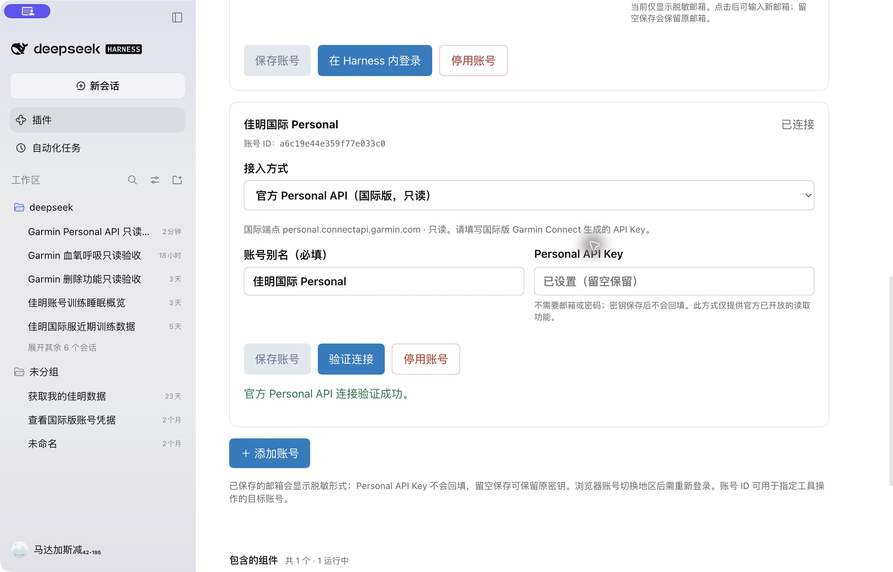

# Personal API 真实桌面 Harness 验收

日期：2026-10-22（Asia/Shanghai）。本报告不包含 API Key、token、Garmin 个人资料响应或健康测量值。截图中的账号 ID 是插件本机的路由标识。

## 环境与结论

| 项目 | 实测结果 |
| --- | --- |
| DeepSeek Harness | macOS 桌面版 `0.2.1-rc.2` |
| 安装位置 | `desktop` profile，插件由 `0.1.18` 更新为 `0.1.19-dev.0` |
| 构建检查 | `npm run build`、`npm run check:sdk` 通过 |
| 安装方式 | 使用桌面应用内置 CLI 安装本地开发包，供应链策略检查通过 |
| 兼容性 | 安装有笼统 peer 警告；实际设置页加载成功，没有兼容性拦截 |
| 对话 | 新建“Garmin Personal API 只读验收”，Flash-1017，高推理 |

**国际 Personal API 已在真实桌面设置页及模型工具调用流程中验证可用。** 本次共 6 次实际工具调用，全部成功；读取到的空值按原响应保留。

## 设置页验收

- 原有大陆、国际两个网页会话账号保留，新增第三个账号，别名为“佳明国际 Personal”，接入模式为 `personal`，区域为 `global`。
- Personal 表单仅有别名和 API Key 两个输入项；Key 为密码输入框，使用本机私密文件中的国际 Key 填写。
- 保存后别名保留，完整 Key 不回填；输入框提示已设置，留空保留。
- 点击验证连接，真实设置页显示：**“官方 Personal API 连接验证成功。”**
- 完全退出并重新打开 Harness 后，别名、稳定账号 ID 和 Key 配置仍保留，再次点击验证连接成功；全程没有重新输入 Key。

## 真实对话工具轨迹

健康数据查询日期均为 **2026-10-21**。

| 调用 | 验证结果 | 数据边界 |
| --- | --- | --- |
| Personal `get_garmin_profile` | 成功；`connection` 中 provider 为 `personal`、region 为 `global`，别名与稳定账号 ID 匹配 | 不记录个人身份字段 |
| Personal `get_garmin_hrv` | 成功，summary 非空 | `hrvReadings` 为 0 条，`lastNightAvg` 为 `null`，不能当作有效 HRV 曲线或测量 |
| Personal `get_garmin_spo2` | 成功，响应结构非空 | `spO2HourlyAverages` 有 24 个小时条目，测量值为 `null`，不代表 24 次有效测量 |
| Personal `get_garmin_respiration` | 成功，`resolution` 为 `daily_summary`，respiration 为 1 条 | 验证每日摘要，不代表完整呼吸曲线 |
| Personal `get_garmin_activities` | 成功，`limit=1` 返回 1 条 | 未读取活动详情或全量历史 |
| 原大陆网页会话 `get_garmin_profile` | 成功，返回独立账号 profile，无 Personal `connection` 字段 | 已核对为不同 profile，未混用新增 Personal 账号 |

已在桌面的“轨迹”页逐项核对工具名、显式账号参数和真实响应，以上均为 Harness 内模型发起的真实工具调用，没有用终端调用替代。未重新登录 Garmin，未写入 Garmin 数据。

## 正式版发布与本机复核

- 官方 npm `latest` 已更新为 `0.1.19`，GitHub 已发布 [v0.1.19](https://github.com/Likenttt/garmin-connect-plugin-for-dsh/releases/tag/v0.1.19)。
- 官方包完整性与发布前校验的安装包一致；217 个编译文件与桌面候选完全一致。
- 全新目录从官方 npm 安装成功，真实 stdio MCP 初始化及 15 项 Personal 工具发现通过；此项没有请求 Garmin 数据。
- 本机使用桌面内置 CLI 将 `desktop` profile 切为官方 npm 的 `dsh-plugin-garmin-connect@0.1.19`。逐文件核对 217 个编译文件均与发布包一致。
- 重开 Harness，界面显示 `v0.1.19` 和正式 npm 来源；原三个账号保留。Personal 账号再次点击验证连接成功，Key 无需重填。
- 发布检查：本机 146 项定向测试通过；[GitHub CI](https://github.com/Likenttt/garmin-connect-plugin-for-dsh/actions/runs/39731558560) 的 Node 20/22 各 1112 项、Windows 15 项、macOS 51 项测试及对应构建通过。

## 尚未覆盖

- 本轮未重测大陆 Personal API。此前独立端点测试返回 HTTP 526，见[区域端点测试报告](../research/personal-api-endpoint-test-report-2026-10-22.md)；不能将其当成本轮桌面测试的新结论。
- 本轮没有有效 HRV 明细或血氧测量值，未验证这两类有效曲线的展示。
- 未测试全部 Personal API、长期运行、Key 过期或撤销后的恢复流程。
- 六次模型工具读取来自发布候选；正式 npm 包已完成安装、编译文件一致性和设置页连接复核。

复现安装和设置步骤见[本机验证指南](../guides/personal-api-local-validation.zh-CN.md)。
